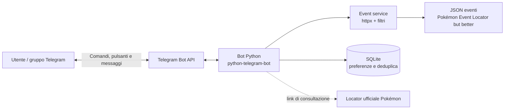

# High-Level Design — Bot Telegram Pokémon VGC

**Stato:** descrive l'implementazione presente nel repository.  
**Linguaggio:** italiano.  
**Data:** 28 novembre 2026.

## 1. Obiettivo

Fornire in una chat Telegram avvisi sui nuovi tornei VGC di una regione e un riepilogo dei tornei del mese corrente, con possibilità di eseguire ricerche una tantum usando regione e filtri scelti dall'utente.

La regione configurata nella chat è la preferenza persistente usata dagli avvisi automatici e da `/recap`. La ricerca `/cerca` mantiene regione e filtri solo per la ricerca in corso.

## 2. Ambito

### Incluso

- Configurazione e modifica della regione per chat privata o gruppo.
- Avvisi per nuovi eventi VGC `Video Game` con tag `league_challenge` o `league_cup`.
- Recap manuale del mese corrente e recap automatico mensile configurabile.
- Ricerca una tantum con scelta di regione, gioco e tipo di evento.
- Deduplicazione degli avvisi e memorizzazione delle preferenze tramite SQLite.
- Visualizzazione di sede, indirizzo, data e ora locali, eventuale costo e link disponibili.

### Escluso

- Registrazione o iscrizione ai tornei.
- Gestione di tornei, organizzatori, risultati o classifiche.
- Copertura di più regioni per la stessa chat.
- Scraping diretto dell'interfaccia del locator ufficiale.

## 3. Attori e interfacce

- **Utente Telegram:** configura la chat e consulta avvisi o recap.
- **Bot Telegram:** gestisce comandi, pulsanti inline e invio messaggi tramite Telegram Bot API.
- **Catalogo eventi:** JSON pubblicato dal progetto Pokémon Event Locator but better, che dichiara di raccogliere i dati dal locator ufficiale.
- **Operatore:** configura token, polling, database e recap automatico tramite variabili d'ambiente.

Comandi esposti:

| Comando | Scopo |
| --- | --- |
| `/start` | Imposta o riseleziona la regione della chat |
| `/regione`, `/region` | Cambia la regione della chat |
| `/recap` | Invia il recap VGC del mese corrente per la regione salvata |
| `/cerca` | Apre una ricerca una tantum con regione e filtri personalizzabili |

## 4. Architettura logica

Il processo Python mantiene il polling Telegram e un task asincrono di monitoraggio eventi. Le chiamate HTTP al catalogo sono eseguite fuori dall'event loop tramite un thread. La persistenza locale è separata dalla logica del bot.

## 5. Componenti

| Componente | Responsabilità | Implementazione |
| --- | --- | --- |
| Telegram application | Avvio, polling, dispatch dei comandi e callback | `python-telegram-bot` in [bot.py](../bot.py) |
| Conversation/UI | Scelta regione e filtri tramite tastiere inline | Handler in [bot.py](../bot.py) |
| Event service | Download JSON, normalizzazione, filtri, ordinamento e formattazione | [events.py](../events.py) |
| Monitor | Controllo periodico, invio notifiche e recap automatico | Task asincrono in [bot.py](../bot.py) |
| Store | Regione per chat, ID eventi già notificati, recap già inviati | SQLite in [storage.py](../storage.py) |
| Configurazione | Token, percorso DB, intervallo e parametri recap | Variabili `.env`, descritte in [.env.example](../.env.example) |

## 6. Fonti dati e filtri

### Fonte strutturata usata dall'applicazione

Il bot scarica `data/events.json` dal sito [Pokémon Event Locator but better](https://shairaba.github.io/pokemon-events-italia/index.html). La risposta è un catalogo nazionale strutturato; il codice normalizza identificativo, regione, prodotti, tag, data, sede, indirizzo e link. La disponibilità e la frequenza degli aggiornamenti dipendono dal catalogo upstream.

### Locator ufficiale

Il [locator ufficiale Pokémon](https://events.pokemon.com/EventLocator/) è incluso nei messaggi come collegamento per consultazione. L'implementazione corrente **non** interroga direttamente il suo backend: la ricerca ufficiale osservata è geografica, basata su località e raggio, e non fornisce al bot un elenco nazionale per regione. Il catalogo italiano ottenuto tamite scraping dal tool di Shai Rabà resta quindi la fonte dati strutturata dell'applicazione.

### Regole di selezione

- Default per avvisi e recap: il prodotto deve contenere `vg` e i tag devono includere `league_challenge` o `league_cup`.
- Il recap limita inoltre i risultati al mese corrente in `Europe/Rome` e alla regione salvata.
- `/cerca` usa come valori iniziali gli stessi filtri VGC, ma permette di selezionare regione, gioco (`vg`, `tcg`, `pgo`) e tipo evento.
- Gli eventi sono ordinati per data/ora di inizio. Le date vengono visualizzate in `Europe/Rome`.

## 7. Flussi principali

### 7.1 Configurazione e cambio regione

1. `/start` o `/regione` mostra le regioni supportate.
2. La selezione aggiorna la regione associata al `chat_id` della chat Telegram; per un gruppo viene quindi salvata una preferenza condivisa da quel gruppo.
3. Il bot acquisisce gli ID già presenti per la regione come baseline, evitando di inviare notifiche arretrate.
4. La nuova regione vale per gli avvisi automatici e per `/recap`.

### 7.2 Ricerca una tantum

1. `/cerca` carica la regione salvata come scelta predefinita e apre i filtri VGC standard.
2. L'utente può cambiare la regione nella UI della ricerca e modificare i filtri di gioco e tipo evento.
3. La ricerca recupera il catalogo, applica tutti i filtri e invia i risultati in un unico messaggio Telegram, soggetto al limite di lunghezza del messaggio.
4. La regione temporanea non viene scritta in SQLite e non cambia preferenze, avvisi o recap.

### 7.3 Monitoraggio e notifica

1. Il task legge il catalogo ogni `POLL_INTERVAL_SECONDS` (default 300 secondi; minimo 60).
2. Per ogni chat configurata seleziona gli eventi VGC della regione il cui ID non compare in `seen_events`.
3. Invia un messaggio per ogni nuovo evento e registra l'ID per impedire duplicati dopo riavvii.
4. Un errore del catalogo o dell'invio viene registrato nei log; il ciclo successivo riprova.

L'intervallo del bot limita solo la frequenza delle richieste: la latenza effettiva di rilevamento dipende anche da quando il catalogo upstream pubblica i dati.

### 7.4 Recap

- `/recap` scarica gli eventi e restituisce un solo messaggio con i tornei VGC del mese corrente.
- Se l'elenco eccede il limite Telegram, il messaggio include i primi eventi che entrano e indica quanti ne sono stati omessi.
- Il recap automatico è disattivato di default; se abilitato, giorno e ora sono configurabili. L'invio già effettuato viene registrato per chat e mese.

## 8. Dati e persistenza

Database SQLite locale, inizializzato automaticamente.

| Tabella | Campi principali | Finalità |
| --- | --- | --- |
| `subscribers` | `chat_id` (PK), `region` | Una regione persistente per chat |
| `seen_events` | `chat_id`, `event_id` (PK composta) | Deduplicazione degli avvisi |
| `monthly_recaps` | `chat_id`, `month` (PK composta) | Invio automatico mensile al massimo una volta per mese |

Il database deve risiedere su storage persistente dell'host. Backup, migrazione e retention non sono automatizzati dall'applicazione.

## 9. Requisiti operativi e deployment

- Runtime Python compatibile con le dipendenze dichiarate in [requirements.txt](../requirements.txt); lo sviluppo attuale usa Python 3.14.4.
- Il processo deve rimanere attivo per gestire il polling Telegram e il monitoraggio periodico.
- `TELEGRAM_BOT_TOKEN` è obbligatorio. Il file `.env` non va versionato.
- `DATABASE_PATH` deve puntare a un disco persistente; il default è `./data/bot.sqlite3`.
- L'impostazione del loop asyncio in `main()` è presente per l'avvio nell'ambiente Python 3.14.4 corrente.
- La distribuzione può essere fatta su una VM o su un servizio container con processo persistente. Piattaforme a esecuzione effimera richiedono una revisione dell'architettura e della persistenza.

Variabili principali:

| Variabile | Default | Descrizione |
| --- | --- | --- |
| `TELEGRAM_BOT_TOKEN` | obbligatoria | Credenziale Bot API |
| `DATABASE_PATH` | `./data/bot.sqlite3` | Percorso SQLite |
| `POLL_INTERVAL_SECONDS` | `300` | Frequenza di lettura del catalogo |
| `TIMEZONE` | `Europe/Rome` | Fuso orario del recap automatico |
| `AUTO_MONTHLY_RECAP` | `false` | Attiva il recap automatico |
| `MONTHLY_RECAP_DAY` | `1` | Giorno configurato (1–28) |
| `MONTHLY_RECAP_HOUR` | `9` | Ora locale configurata |

## 10. Sicurezza, privacy e osservabilità

- Il token Telegram va fornito tramite secret manager o variabile d'ambiente, mai nel codice o nei log.
- Il database contiene ID chat Telegram, regione scelta e cronologia tecnica degli invii; limitarne accesso e backup agli operatori autorizzati.
- Il bot non richiede coordinate, nome reale o posizione dell'utente.
- I log riportano errori di sorgente e ciclo monitor; non è presente una dashboard o un sistema di alerting esterno.
- Le risposte Telegram sono inviate in testo semplice; link e dati dell'evento provengono dalla sorgente esterna e vanno trattati come contenuto non attendibile.

## 11. Limiti e rischi noti

1. **Dipendenza da una fonte community:** se il JSON cambia schema o smette di aggiornarsi, il fetch può fallire o omettere eventi. L'URL ufficiale mostrato nei messaggi non è un fallback automatico.
2. **Nessun fallback diretto al locator ufficiale:** per aggiungerlo servirebbe un adapter supportato e testato che risolva la ricerca geografica e le API del sito ufficiale.
3. **Processo singolo:** più istanze concorrenti possono duplicare polling e messaggi. Il design assume una sola istanza attiva.
4. **Storage locale:** perdita o ricreazione del disco cancella iscrizioni, deduplica e stato recap.
5. **Rate limit e indisponibilità:** errori Telegram o HTTP interrompono il ciclo corrente; i nuovi tentativi avvengono al giro successivo e non esiste una coda durevole di invio.
6. **Comandi in gruppi:** la configurazione è per chat, non per singolo membro; una selezione in gruppo cambia l'area per l'intero gruppo.

## 12. Decisioni architetturali e possibili evoluzioni

- **Python:** mantiene l'implementazione semplice per parsing HTTP, bot Telegram e SQLite.
- **Long polling:** non richiede un endpoint pubblico, ma richiede un processo persistente.
- **SQLite:** adeguato a un bot leggero con una singola istanza; per più istanze o alta disponibilità occorre un database condiviso e deduplica atomica.
- **Adapter delle fonti:** evolvere `events.py` per isolare il catalogo community e un eventuale client ufficiale, unificare i record e deduplicare per GUID/display ID.
- **Test automatici:** aggiungere test di parsing, filtri, callback della regione temporanea, limite messaggi e deduplicazione prima di adottare nuove fonti o deployment multi-istanza.
- **Deployment GitHub Actions:** possibile solo trasformando il processo in job a esecuzione finita e spostando lo stato su storage durevole; non è il target operativo di questo HLD.
